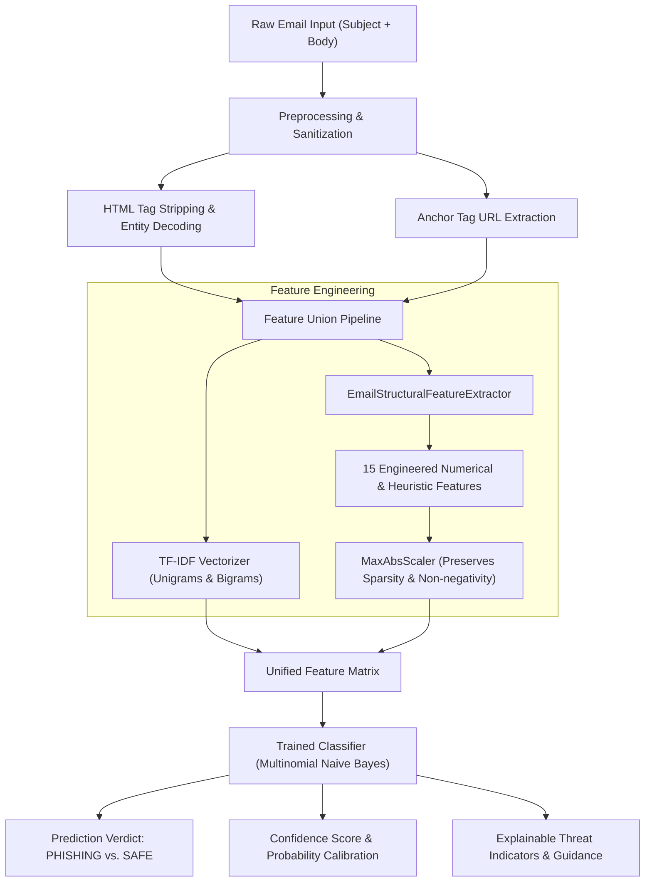

# PhishGuard AI: Phishing Email Detection System Using Machine Learning


An original, production-grade cybersecurity application that detects and analyzes phishing emails using Natural Language Processing (NLP), structural URL heuristics, and supervised Machine Learning classifiers. Built with Python 3.13, Scikit-learn, and Streamlit.

---

## 📑 Table of Contents
1. [Project Overview](#1-project-overview)
2. [Key Capabilities & Features](#2-key-capabilities--features)
3. [System Architecture](#3-system-architecture)
4. [Dataset Provenance, Composition & Limitations](#4-dataset-provenance-composition--limitations)
5. [Data Leakage Mitigation & Evaluation Methodology](#5-data-leakage-mitigation--evaluation-methodology)
6. [Feature Engineering Pipeline](#6-feature-engineering-pipeline)
7. [Machine Learning Models & Benchmark Results](#7-machine-learning-models--benchmark-results)
8. [Project Directory Structure](#8-project-directory-structure)
9. [Installation & Setup](#9-installation--setup)
10. [Running the Application](#10-running-the-application)
11. [Automated Testing & QA](#11-automated-testing--qa)
12. [Cybersecurity & Ethical Disclaimer](#12-cybersecurity--ethical-disclaimer)

---

## 1. Project Overview

Email phishing remains the leading initial vector in corporate security breaches, powering ransomware delivery, credential harvesting, and Business Email Compromise (BEC). Traditional signature-based filters frequently struggle against novel domains, obfuscated links, and social engineering language patterns.

**PhishGuard AI** addresses this challenge through a multi-layered defense architecture:
- **Lexical & Text Semantics:** TF-IDF unigram and bigram representation of subject lines and email body text.
- **Static URL Heuristics:** Zero-contact inspection of embedded hyperlinks (detecting numerical IP hosts, dangerous TLDs, excessive subdomains, and obfuscating `@` symbols).
- **Linguistic Manipulation Indicators:** Psychological urgency scoring, credential triggers, financial wire phrases, and uppercase shouting ratios.
- **Supervised Machine Learning:** Evaluated and benchmarked across Logistic Regression, Multinomial Naive Bayes, and Random Forest Classifier using leak-free group-based evaluation.

---

## 2. Key Capabilities & Features

### 🔍 Live Email Scanner
- Analyzes custom email subject and body inputs with instant classification as **PHISHING** or **SAFE**.
- Displays estimated prediction confidence score ($0.0\% - 100.0\%$).
- Categorizes threat level: `CRITICAL RISK`, `HIGH RISK`, `MEDIUM RISK`, or `LOW RISK`.
- Provides an explainable diagnostic breakdown of detected urgency cues, credential triggers, financial keywords, and embedded link statuses.
- Includes 1-click sample loaders for authentic attack archetypes (PayPal dispute, Microsoft 365 password expiration, Chase wire fraud) and legitimate corporate communications (sprint planning, Amazon shipment, HR benefits).

### 🌐 Static URL Security Heuristic Engine
- Extracts all embedded URLs from text safely without initiating network requests.
- Evaluates:
  - Raw numerical IP hosts (e.g. `http://192.168.1.100/...`).
  - High-risk TLDs (`.xyz`, `.top`, `.ru`, `.work`, `.club`, etc.).
  - Excessive subdomain depth (indicative of domain spoofing).
  - Deceptive `@` character tricks.
  - Unencrypted HTTP vs. encrypted HTTPS protocols.
  - Deceptive path keywords (`login`, `verify`, `banking`, `secure`).

### 📊 Model Performance & Benchmark Suite
- Transparent side-by-side comparison of **Logistic Regression**, **Multinomial Naive Bayes**, and **Random Forest Classifier**.
- Evaluated on a **leak-free holdout test split** with **zero template overlap** via `StratifiedGroupKFold`.
- Visualizations including Confusion Matrix Heatmap and Algorithm Comparison Bar Charts.
- Full Scikit-learn Classification Reports for both classes.

### 📁 Dataset Explorer
- Interactive table preview with keyword search and class filtering.
- Visual charts depicting class balance (Phishing vs. Safe) and sub-category distributions.

### 🛡️ Cybersecurity Awareness Center
- Educational briefings on Spear Phishing, Whaling, BEC, Quishing (QR Phishing), and Credential Harvesting.
- Interactive "7 Critical Red Flags Checklist" and everyday email hygiene best practices.

---

## 3. System Architecture



---

## 4. Dataset Provenance, Composition & Limitations

### Transparent Provenance Disclosure
The dataset (`data/emails.csv`) contains **341 email records** and is **entirely internally authored and synthetically generated**. It does **not** contain records directly downloaded from external public archives (such as SpamAssassin, Jose Nazario, or Enron).

### Composition Breakdown:
| Component | Record Count | Percentage | Description |
| :--- | :---: | :---: | :--- |
| **Manually Authored Seeds** | **80** | **23.46%** | High-fidelity seed emails (40 Phishing, 40 Safe) manually crafted to represent authentic real-world scenarios. |
| **Synthetically Generated Variations** | **261** | **76.54%** | Parameterized variations (138 Phishing, 123 Safe) generated by cycling institutions, amounts, case IDs, and mock domains through structured templates. |
| **Total Verified Records** | **341** | **100.00%** | Cleaned and deduplicated records (`178 PHISHING` / `163 SAFE`). |

### Schema (`data/emails.csv`)
| Column | Description |
| :--- | :--- |
| `subject` | Email subject header |
| `body` | Email body content |
| `category` | Sub-category (e.g. Credential Harvesting, Financial Scam, Workplace Collaboration) |
| `label` | Numerical label: `1` = PHISHING, `0` = SAFE |
| `label_text` | Normalized string label: `PHISHING` or `SAFE` |
| `source` | Source provenance reference |
| `full_text` | Cleaned combined subject and body text |

### Documented Limitations:
1. **Compact Sample Size:** 341 total records provide a controlled benchmark for pipeline testing and demonstration, but cannot fully replicate the diversity of enterprise mail streams.
2. **Template Redundancy:** Because 76.5% of records are template-generated variations, conventional random splitting causes data leakage unless group-based splitting is enforced.
3. **Mock URLs:** Hyperlinks in the dataset use non-resolving mock domains and RFC-2606 test addresses.
4. **Production Generalization:** Deployment in production environments requires continuous fine-tuning against large, organic enterprise mail logs.

---

## 5. Data Leakage Mitigation & Evaluation Methodology

### Investigation of Data Leakage
An initial investigation demonstrated that conventional random stratified splitting (`train_test_split`) allowed near-duplicate template variants to be divided between the training set and the test set. Specifically, **42.0% (29 out of 69) of test samples** shared an identical subject and near-identical body with training samples, artificially inflating test metrics through memorization.

### Group-Based Mitigation (`StratifiedGroupKFold`)
To eliminate template leakage and measure true generalization:
1. **Template Fingerprinting:** Each email subject is mapped to a normalized template group fingerprint (`re.sub(r'#\d+', '#ID', subj)...`).
2. **Group-Based Partitioning:** The dataset is split using **`StratifiedGroupKFold(n_splits=5, shuffle=True, random_state=42)`**.
3. **Zero Template Overlap:** All variations of any given template reside exclusively in the training split or exclusively in the test split (**0 group overlap verified**).
4. **Generalization Challenge:** Models are evaluated on truly unseen templates and challenging edge cases (e.g. URL-less spear phishing and extortion scams).

---

## 6. Feature Engineering Pipeline

The system integrates engineered features directly into the model training pipeline via Scikit-learn's `FeatureUnion`:

### A. Text Representations
- **TF-IDF Vectorizer**: Sublinear term frequency, unigrams & bigrams `(1, 2)`, English stopwords removal, 2500 max features.

### B. Structural & Heuristic Features (15 Engineered Dimensions)
1. `url_count`: Total embedded URLs in message.
2. `url_avg_length`: Average character length of embedded URLs.
3. `url_has_ip`: Binary flag indicating numerical IPv4 host.
4. `url_has_suspicious_tld`: Binary flag indicating high-risk TLD.
5. `url_excessive_subdomains`: Flag indicating $>2$ subdomain levels.
6. `url_has_at_symbol`: Flag indicating `@` symbol in link.
7. `url_http_only_ratio`: Proportion of unencrypted HTTP links.
8. `url_suspicious_structure_count`: Count of deceptive path keywords (`login`, `verify`, `banking`, etc.).
9. `linguistic_urgency_count`: Frequency of urgency triggers (`immediate`, `within 24 hours`, `suspended`, `expire`).
10. `linguistic_credential_count`: Frequency of credential harvesting keywords (`password`, `ssn`, `credentials`, `login`).
11. `linguistic_financial_count`: Frequency of financial/transactional terms (`wire transfer`, `invoice`, `bank`, `refund`).
12. `linguistic_cta_count`: Frequency of call-to-action commands (`click here`, `update your account`, `confirm identity`).
13. `linguistic_uppercase_ratio`: Ratio of uppercase characters to total letters (shouting/urgency).
14. `linguistic_exclamation_count`: Frequency of exclamation marks (`!`).
15. `text_log_char_length`: Log-transformed text character length.

---

## 7. Machine Learning Models & Benchmark Results

### A. Leak-Free Holdout Test Split Evaluation
Evaluated on **66 holdout emails (33 Phishing, 33 Safe)** with **zero template overlap** with the 275 training emails:

| Algorithm | Accuracy | Precision (Phishing) | Recall (Phishing) | F1-Score (Phishing) | Macro F1 | ROC-AUC | Status |
| :--- | :---: | :---: | :---: | :---: | :---: | :---: | :---: |
| **Multinomial Naive Bayes** | **98.48%** | **100.00%** | **96.97%** | **0.9846** | **0.9848** | **1.0000** | 🏆 **Champion Model** |
| **Logistic Regression** | 96.97% | 100.00% | 93.94% | 0.9688 | 0.9697 | 1.0000 | Benchmark Candidate |
| **Random Forest Classifier** | 96.97% | 100.00% | 93.94% | 0.9688 | 0.9697 | 1.0000 | Benchmark Candidate |

### B. 5-Fold Stratified Group Cross-Validation Summary
To verify stability across all 103 template clusters across the entire corpus:

| Algorithm | Mean CV Accuracy | Mean CV Precision | Mean CV Recall | Mean CV F1-Score |
| :--- | :---: | :---: | :---: | :---: |
| **Multinomial Naive Bayes** | **99.39% ($\pm 0.75\%$)** | **99.39% ($\pm 1.21\%$)** | **99.39% ($\pm 1.21\%$)** | **0.9938 ($\pm 0.0075$)** |
| **Logistic Regression** | 99.39% ($\pm 1.21\%$) | 100.00% ($\pm 0.00\%$) | 98.79% ($\pm 2.42\%$) | 0.9938 ($\pm 0.0125$) |
| **Random Forest Classifier** | 99.39% ($\pm 1.21\%$) | 100.00% ($\pm 0.00\%$) | 98.79% ($\pm 2.42\%$) | 0.9938 ($\pm 0.0125$) |

### Evaluation Visualizations
- **Confusion Matrix:** Saved at `outputs/confusion_matrix.png` and `images/confusion_matrix.png`.
- **Model Comparison:** Saved at `outputs/model_comparison.png` and `images/model_comparison.png`.

---

## 8. Project Directory Structure

```
Phishing_Email_Detection_V2/
│
├── app.py                     # Streamlit Cybersecurity Web Application
├── train_model.py             # CLI Model Training & Benchmark Pipeline
├── requirements.txt           # Project Dependencies (Python 3.13 Compatible)
├── README.md                  # Comprehensive Documentation
├── .gitignore                 # Git Ignore Rules
├── run_app.bat                # Windows 1-Click Launch Script
│
├── src/
│   ├── __init__.py            # Package Initializer
│   ├── preprocessing.py       # HTML Stripping, Normalization, Validation
│   ├── feature_extraction.py  # URL Heuristics, Linguistic Scoring, Transformer
│   ├── model_training.py      # Duplicate-Aware Group-Based Training Pipeline
│   ├── prediction.py          # Production Inference Engine & Reasoning
│   └── evaluation.py          # Metric Computations & Seaborn Charts
│
├── data/
│   ├── README.md              # Dataset Documentation & Provenance Disclosure
│   ├── download_dataset.py    # Dataset Preparation, Cleaning & Balancing Script
│   └── emails.csv             # Curated Benchmark Email Dataset (341 records)
│
├── models/
│   ├── phishing_detector_model.joblib  # Serialized Champion Pipeline Artifact
│   └── model_metadata.json             # Model Parameters, Metrics & Training Metadata
│
├── outputs/
│   ├── model_metrics.json     # Quantitative Benchmark Metrics
│   ├── confusion_matrix.png   # Champion Confusion Matrix Heatmap
│   └── model_comparison.png   # 3-Model Comparison Bar Chart
│
├── tests/
│   ├── __init__.py            # Test Package Initializer
│   ├── test_preprocessing.py  # Unit Tests: Cleaning & Normalization
│   ├── test_feature_extraction.py # Unit Tests: URL Heuristics & Transformer
│   ├── test_model_training.py # Unit Tests: Pipeline Training & Metrics
│   ├── test_prediction.py     # Unit Tests: Inference, Confidence & Edge Cases
│   └── test_integration.py    # End-to-End Pipeline Integration Tests
│
└── images/
    ├── confusion_matrix.png   # Exported Chart Copy
    └── model_comparison.png   # Exported Chart Copy
```

---

## 9. Installation & Setup

### Prerequisites
- Python 3.13 (or compatible Python 3.10+ installation)
- Windows, macOS, or Linux

### Installation Steps
```bash
# Clone or navigate to the project directory
cd Phishing_email_detection_v2

# Install required dependencies
pip install -r requirements.txt
```

---

## 10. Running the Application

### Option A: Using the Windows Batch Script
Simply double-click `run_app.bat` or execute in PowerShell / Command Prompt:
```cmd
run_app.bat
```

### Option B: Using Python & Streamlit Directly
```bash
# 1. (Optional) Run the leak-free model training pipeline
python train_model.py

# 2. Launch the Streamlit dashboard
streamlit run app.py
```
Open your browser and navigate to: `http://localhost:8501`

---

## 11. Automated Testing & QA

The project includes an automated test suite implemented with Pytest, covering text cleaning, URL heuristics, pipeline dimensions, model serialization, and end-to-end edge cases.

To execute the entire test suite:
```bash
pytest -v
```

---

## 12. Cybersecurity & Ethical Disclaimer

> [!IMPORTANT]
> **Safety Notice:**
> 1. **Zero-Contact Policy:** This software uses purely static regex and lexical parsing for URL and email inspection. It **never** sends HTTP requests, queries DNS, or accesses external websites submitted for analysis.
> 2. **Probabilistic Assistance:** Machine learning predictions are statistical estimates based on historical patterns and should **not** be treated as definitive legal or cryptographic security verdicts.
> 3. **Defense-in-Depth:** Organizations should deploy PhishGuard AI alongside email authentication protocols (SPF, DKIM, DMARC), hardware Multi-Factor Authentication (MFA), and ongoing security awareness training.
